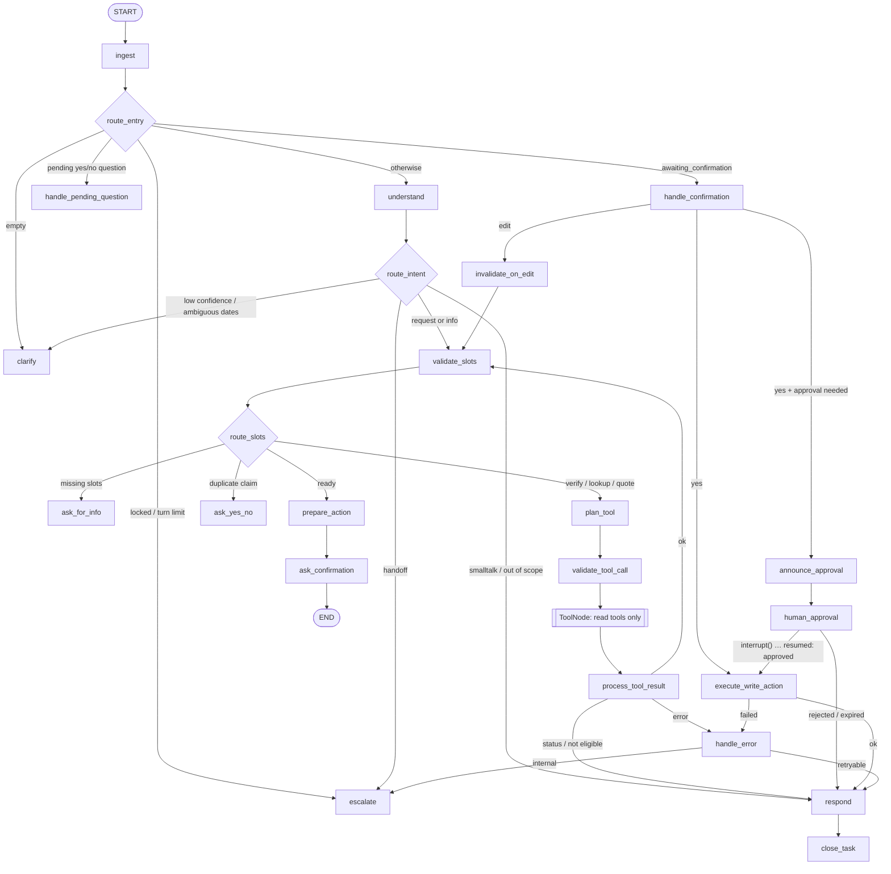

# Insurance Support Agent (LangGraph)

A production-style customer-support agent for a fictional auto insurer, **Acme Mutual**, built with [LangGraph](https://github.com/langchain-ai/langgraph). It handles three requests over multi-turn conversations:

| Request | Tool type | Human approval |
|---|---|---|
| Check policy status | read | no |
| Report a vehicle claim | write | when injuries are reported, the estimate is ≥ $10,000, or there's no estimate |
| Request policy cancellation | write | always |

The agent understands the request, collects missing information, verifies identity, calls the right (mock) backend tool, asks a human reviewer before risky writes, recovers from failures, and returns a clear final answer. The LLM handles language; **deterministic graph code controls routing, validation, authorization and approvals**.

- **Spec:** [`docs/PRD.md`](docs/PRD.md)
- **Design rationale:** [`docs/design-decisions.md`](docs/design-decisions.md)
- **Graph:** [`docs/graph.md`](docs/graph.md) (generated)
- **Choices the PRD left open:** [`DECISIONS.md`](DECISIONS.md)
- **Milestones:** [`CHECKPOINTS.md`](CHECKPOINTS.md)

---

## Quick start (clean clone, no API key)

Requires **Python 3.11+**, `make` and `git`. Nothing else, and no network access after `make install`.

```bash
git clone <this repo> insurance-support-agent && cd insurance-support-agent
make install     # creates .venv and installs the pinned dependencies (requirements.lock)
make demo        # scripted demo: all three requests + human approval (approve and reject)
make check       # ruff + mypy --strict + the full test suite in both tool-selection modes
```

`make demo` starts its own API on a free localhost port with temporary databases, the fake LLM, and `APP_TODAY=2026-10-22` (the date used throughout the PRD examples). It then plays the customer over HTTP and the reviewer through the real `support` CLI. Nothing is written under `data/`.

<details>
<summary>What the demo shows (abridged)</summary>

```text
1. Check policy status
 Customer: Hi, can you check if my policy is still active?
    Agent: Hi, I'm the Acme Mutual support assistant. I can help with that. Please provide your
           policy number (format POL-123456) and your date of birth.
 Customer: POL-100001, born April 12 1985
    Agent: Your policy POL-100001 for the 2022 Toyota Camry is ACTIVE. Coverage period: 2026-01-01
           to 2026-12-31. Premium paid through 2026-12-31. Coverages: Liability, Collision ($500
           deductible), Comprehensive ($250 deductible). Is there anything else I can help with?

2. Report a vehicle claim
 Customer: I got rear-ended yesterday.            (identity is already verified in this thread)
    Agent: I'm sorry to hear that. I'll help you report a claim. Where did the incident happen?
 ...       (location → injuries/other party → optional estimate/police report → summary)
 Customer: yes
    Agent: Your claim CLM-2026-000002 has been filed. An adjuster will contact you within 2
           business days.

3. Request a cancellation (always human-approved)
 Customer: Now I'd like to cancel the policy.  →  Nov 1, switching provider
    Agent: Cancelling POL-100001 effective 2026-11-01 ... Estimated refund: $175.55 (pro-rated for
           61 of 365 days on a $1,200 premium, minus $25 cancellation fee) ... (yes / no / edit)
 Customer: yes
    Agent: Your request has been sent to a support specialist for approval. Reference: APR-XXXXX...
 Customer: any update?
    Agent: Your request APR-XXXXX is still pending review. ...
 Reviewer: $ support approvals list
 Reviewer: $ support approvals decide APR-XXXXX --approve --comment "Verified, processed."
    Agent: Your cancellation was approved. Policy POL-100001 will be cancelled effective
           2026-11-01. Confirmation: CNL-2026-000001. Estimated refund $175.55 within 7–10
           business days. Note from specialist: "Verified, processed."

4. A claim that needs review (injury, no estimate), rejected by the reviewer
```
</details>

## Try it interactively (no API key)

Use three terminals in the repo directory.

```bash
# Terminal 1: the API (fake LLM, APP_TODAY=2026-10-22; seeds data/app.db on first start)
make run-offline

# Terminal 2: you are the customer
.venv/bin/support chat
#   /refresh shows messages added by a reviewer decision; /quit exits

# Terminal 3: you are the reviewer
.venv/bin/support approvals list
.venv/bin/support approvals decide APR-XXXXX --approve --comment "Verified, processed."
.venv/bin/support approvals decide APR-XXXXX --reject  --comment "Please call us."
```

Things to type in `support chat`:

| Try | Say |
|---|---|
| Status | `is my policy active? POL-100001, born April 12 1985` |
| Identity first | `POL-100001, DOB 4/12/1985` then `is it active?` |
| Claim (no approval) | `I got rear-ended yesterday.` → identity → `Main St & 5th Ave, Springfield` → `No injuries, yes another car` → `about 2500, no report` → `yes` |
| Claim (needs approval) | Same as above, but answer the estimate question with `skip`. Then decide it as the reviewer. |
| Edit at confirmation | At a summary: `yes, but change the location to Main St & 6th` or `ok, actually the date was the 20th` |
| Cancellation + approval | `I want to cancel my insurance.` → identity → `Nov 1, switching provider` → `yes` → approve in terminal 3 → `/refresh` |
| Duplicate claim | `I need to file a claim, my car was hit on 10/15. POL-100006 born 2/28/1970` |
| Lapsed policy | `status of POL-100002 please, dob 9/30/1990` |
| Handoff | `let me talk to a person` (works at any point, including at a summary) |
| Write failure + retry | Set `MOCK_FAULTS=true` in terminal 1, then cancel `POL-999501` (DOB `1/1/2000`), approve it, and reply `retry` or `no` |

Reviewer and admin commands send `REVIEWER_TOKEN` / `ADMIN_TOKEN` (default `change-me`, set them in `.env`). The API listens on `SUPPORT_API_URL` (default `http://127.0.0.1:8000`). `make reset` deletes `data/*.db` and re-seeds.

> **About the fake LLM.** With `LLM_PROVIDER=fake`, language understanding comes from `FakeScriptedChatModel`. It is a real LangChain chat model that answers with rule-based heuristics (or scripted responses in tests). It covers the phrasings above well, but it is not a language model: unusual phrasings work better with a real Claude model.

## Using a real Claude model

```bash
cp .env.example .env
# edit .env: ANTHROPIC_API_KEY=sk-ant-...   (LLM_PROVIDER=anthropic is the default)
make run
```

The default model is `claude-sonnet-5-5` (`LLM_MODEL`), at temperature 0, with `max_tokens=1024` and one SDK retry. If the key is missing, the API logs `llm_key_missing` at startup and every LLM call falls back to rules (FR48). Optional LangSmith tracing turns on when `LANGSMITH_API_KEY` is set.

`TOOL_SELECTION_MODE=deterministic` skips the LLM in `plan_tool`: the read tool is chosen from a fixed (intent, phase) table, and the behavior is otherwise identical.

---

## Architecture



This is simplified. The exact generated diagram is in [`docs/graph.md`](docs/graph.md) (`make graph`), and every edge is specified in PRD §8.3.

**Key ideas** (details in [`docs/design-decisions.md`](docs/design-decisions.md)):

- **Typed state, checkpointed every step.** `SupportState` (`app/graph/state.py`) is exactly the PRD schema, and a node that writes an unknown key fails. `SqliteSaver` persists every super-step in `data/checkpoints.db`.
- **Pure routing.** All conditional edges live in `app/graph/routing.py`, are pure functions of state, and have table-driven tests.
- **Tools proposed by the LLM, guarded by code.** `plan_tool` binds only allowlisted read tools. `validate_tool_call` rejects anything else and overwrites the arguments from verified state.
- **Writes only through `execute_write_action`.** The FR26 guard checks verified identity, a confirmed payload and a matching approval. Writes are idempotent per attempt (FR27).
- **Human-in-the-loop with `interrupt()`.** `announce_approval` does all the side effects (the approval row and the "sent for review" message). `human_approval` only interrupts. Reviewers decide through `POST /approvals/{id}/decision`, which resumes the graph with `Command(resume=...)`.
- **Messages while an approval is pending never invoke the graph.** They get a "still pending" side reply. Expiry is lazy, crash windows are repaired by `ensure_interrupt()`, and all of it runs under per-thread locks (`app/runtime.py`).
- **Errors.** Retries happen inside the tool wrapper only. A read failure is retried on the next message, with corrections applied first. An approved write that fails is retried only on the customer's "retry", and its real outcome is checked by idempotency key before the customer is told anything.
- **Responses.** Decision outcomes use templates. LLM prose must pass a fact check and a coverage-language filter.

### Project layout

```
app/
  main.py              FastAPI app (sync handlers, auth, rate limit, /healthz, /metrics)
  runtime.py           §8.8 message handling + decision procedure, per-thread locks, wrappers
  cli.py               `support` CLI (HTTP client of the API)
  llm.py, llm_fake.py  model factory, prompt assembly, DOB redaction, call caps; fake chat model
  prompts/*.md         all prompts (loaded at startup)
  graph/               state, builder, routing, invalidation (FR29a), lifecycle (FR5a), nodes/
  nlu/                 structured-output schemas, redaction, rule-based NLU + fake heuristics
  validation/          slot schemas, validators, FR12a field-aware date extractor
  tools/               @tool definitions, tenacity wrapper, allowlist, errors, idempotency
  mock_api/            mock services (Protocols), repository tables, fault injection
  approvals/           approvals + side-message tables, approvals service
  responses/           templates, outcome rendering, response guard
  observability/       structlog JSON logging, PII masking, Prometheus counters
data/seed/             policies.json, claims.json (`make seed`)
scripts/demo.py        `make demo`
tests/                 unit/, integration/, fixtures/fake_llm.py
```

---

## API

| Method & path | Auth | Purpose |
|---|---|---|
| `POST /threads` | — (rate-limited) | Create a thread → `{thread_id}` |
| `POST /threads/{id}/messages` | — (rate-limited) | `{"content", "client_message_id"?}` → `{messages, status, pending_approval_id}` (content ≤ 2,000 chars, else 422) |
| `GET /threads/{id}` | — | Customer-visible history (side messages merged, DOBs masked) + status |
| `GET /threads/{id}/state` | `X-Admin-Token` | Raw graph state for debugging |
| `GET /approvals?status=pending\|approved\|rejected\|expired` | `X-Reviewer-Token` | Approval queue with customer (masked DOB), payload, risk flags, summary |
| `POST /approvals/{id}/decision` | `X-Reviewer-Token` | `{"decision": "approve"\|"reject", "reviewer_id", "comment"?}`. 409 if the approval is no longer pending (or has expired: the customer is then offered a restart). |
| `GET /healthz` | — | `{"status": "ok"\|"degraded"}` |
| `GET /metrics` | — | Prometheus text counters (NFR17) |

**Security note (MVP):** the `thread_id` (a UUID4) acts as a **bearer secret** for the customer endpoints. Real customer authentication is a non-goal (A9). Brute force is limited by per-thread lockout (3 failed verifications), per-IP rate limiting and, as hardening, a per-policy lockout. Identity verification is policy number + DOB against mock data only.

## Mock data

| Policy | Holder / DOB | Status | Notes |
|---|---|---|---|
| POL-100001 | Jane Doe, 1985-04-12 | ACTIVE | Camry. Flow A/B/C examples ($175.55 refund on Nov 1). |
| POL-100002 | John Smith, 1990-09-30 | LAPSED since 2026-09-01 | $0.00 refund, reinstatement hint |
| POL-100003 | Maria Garcia, 1978-01-22 | CANCELLED (eff. 2026-06-30) | |
| POL-100004 | Wei Chen, 1995-11-03 | ACTIVE | Liability only (collision disclaimer) |
| POL-100005 | Aisha Khan, 1988-07-15 | PENDING_CANCELLATION (eff. 2026-11-15) | |
| POL-100006 | Liam O'Brien, 1970-02-28 | ACTIVE | Open claim CLM-2026-000001 on 2026-10-15 (duplicate test) |
| POL-999500 / 999408 / 999501 / 999502 | "Test …", 2000-01-01 | ACTIVE | With `MOCK_FAULTS=true`: unavailable / timeout / write fails / write commits then times out |

The other fault knobs are `MOCK_FAILURE_RATE`, `MOCK_FAULT_TOOLS`, `MOCK_LATENCY_MS`, `MOCK_SEED`, `MOCK_FAULT_CLEAR_AFTER` and `MOCK_FAULT_LOOKUP` (see `.env.example`).

## Configuration

All settings come from the environment or `.env` ([`.env.example`](.env.example) lists them with defaults). The most useful ones:

| Setting | Default | Meaning |
|---|---|---|
| `LLM_PROVIDER` | `anthropic` | `anthropic` or `fake` |
| `TOOL_SELECTION_MODE` | `llm` | `llm` (Claude proposes read tools) or `deterministic` |
| `APP_TODAY` | current UTC date | Business "today" for all date logic |
| `CLAIM_APPROVAL_THRESHOLD_USD` | `10000` | Claim approval threshold |
| `APPROVAL_TTL_HOURS` | `48` | Approval expiry |
| `MAX_TURNS`, `MAX_VERIFICATION_ATTEMPTS`, `MAX_CLARIFICATION_ATTEMPTS` | 30, 3, 3 | Conversation limits |
| `REVIEWER_TOKEN`, `ADMIN_TOKEN` | `change-me` | Header tokens for reviewer/admin endpoints |
| `APP_DB_PATH`, `CHECKPOINT_DB_PATH` | `data/app.db`, `data/checkpoints.db` | Databases (git-ignored) |

## Tests and quality gates

```bash
make check               # everything below
make lint                # ruff check + ruff format --check (app, tests, scripts) + mypy --strict app
make test-llm            # full suite, TOOL_SELECTION_MODE=llm, coverage ≥ 85% over app/
make test-deterministic  # full suite, TOOL_SELECTION_MODE=deterministic, coverage ≥ 85%
```

- The tests use the fake LLM and **no network**: a socket guard rejects anything but loopback.
- Every test gets its own temporary databases.
- **Unit tests** cover routing tables, the date extractor (relative grammar, year boundaries, ambiguity), validators, the invalidation matrix, the lifecycle, the write guard, idempotency, the refund formula, the response guard and redaction.
- **Integration tests** drive the compiled graph, the runtime, the FastAPI app (`TestClient`) and the CLI against a live Uvicorn server. They cover the PRD flows A–I and F2, approvals (approve, reject, expire, late decision, crash windows, restart, concurrency), the write-retry consent matrix, unknown write outcomes, internal-error escalation, prompt injection and fault injection.
- `make eval` (milestone M10) runs the 60 real-LLM evaluation conversations (needs `ANTHROPIC_API_KEY`; not part of `make check`).

## Packaging notes

Dependencies are pinned exactly in `pyproject.toml`, and the full transitive set in `requirements.lock`. `make install` uses only the standard `venv` + `pip`, and `uv pip install -r requirements.lock` also works. The databases under `data/` and any `.env` are git-ignored.
